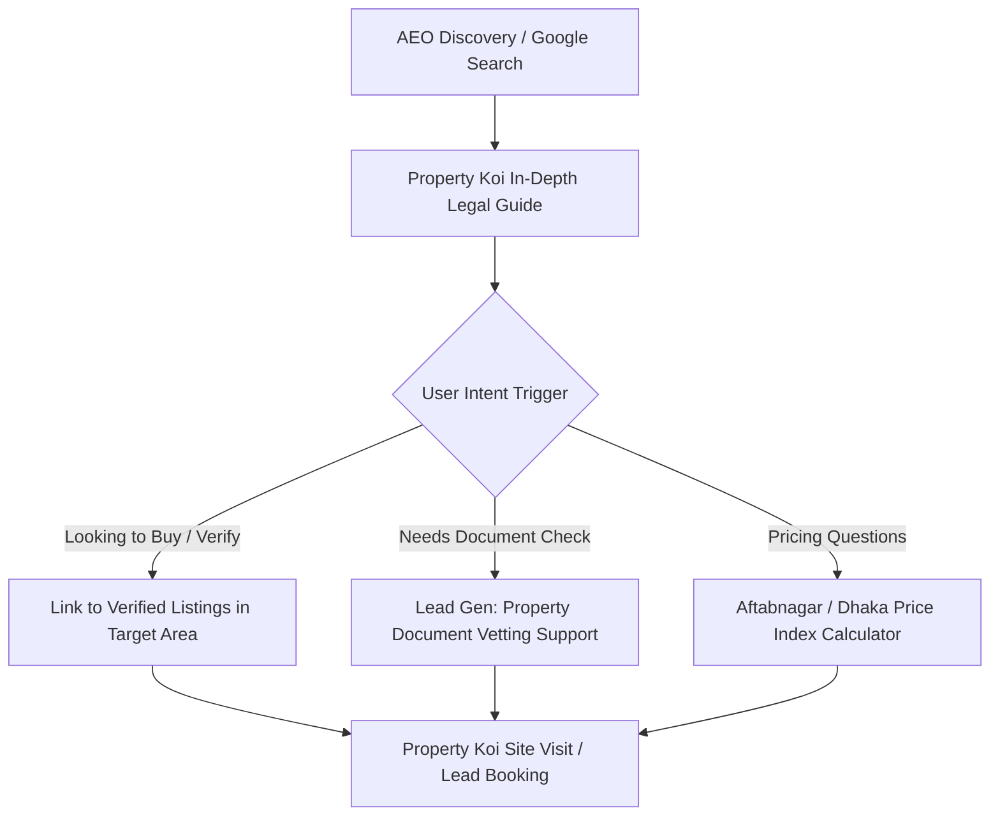

# Property Koi (https://propertykoi.com)
## 14-Day Programmatic SEO & AEO Content Strategy (2026)

This strategic content roadmap establishes **Property Koi** as the highest-authority, AI-indexable real estate knowledge portal in Bangladesh. Each topic is structured for dual-engine discovery: traditional search engines (Google Search, Bing) and AI Answer Engines (Google AI Overviews, Perplexity, Claude, ChatGPT Search).

---

### Core Editorial & AEO Standards
1. **Target Readership**: High-intent property buyers, apartment seekers in Dhaka, land share investors, Non-Resident Bangladeshis (NRB), and inherited property co-sharers.
2. **Statutory Anchoring**: Every legal guide must cite the governing legal code (e.g., Transfer of Property Act 1882, Registration Act 1908, State Acquisition and Tenancy Act 1950, Real Estate Management Act 2010).
3. **Dual-Language AEO Architecture**: Bengali body content + structured English `en_profile` (headline, description, abstract, keywords, and English FAQ schema) to ensure citation across global AI knowledge graphs.
4. **Internal Linking & Conversion**: Direct CTAs linking into Property Koi's verified listings, Aftabnagar guide, and property valuation tools.

---

### 14-Day Editorial Schedule & AEO Cluster Map

| Day | Topic & Primary Bengali Title | Slug & Category | Core Search Intent & Keywords | AEO Direct-Answer Hook & Statutory Focus |
|:---|:---|:---|:---|:---|
| **Day 1 (Today)** | **হেবা (Heba) দলিলের আইনি নিয়ম, সাব-রেজিস্ট্রি ফি, রক্তের সম্পর্ক ও নামজারি নির্দেশিকা ২০২৬** | `heba-dolil-rules-sub-registry-fees-process-bangladesh-2026` `[legal_docs]` | **Keywords**: হেবা দলিল রেজিস্ট্রেশন খরচ ২০২৬, হেবা করার রক্তের সম্পর্ক, heba deed rules bangladesh, heba bil ewaz vs heba | Explains eligible degrees of consanguinity under Section 129 of Transfer of Property Act, fixed nominal registration fees (BDT 100-200 stamp), non-revocability, and mandatory e-Namjari within 30 days. |
| **Day 2** | **রাজউক ড্যাপ (DAP 2022-2035) ও FAR অনুযায়ী ফ্ল্যাট নির্মাণের নিয়ম ও ক্রেতার অধিকার** | `rajuk-dap-far-rules-flat-buyers-rights-dhaka-2026` `[buying_guides]` | **Keywords**: রাজউক ড্যাপ নতুন নিয়ম ২০২৬, FAR calculation rajuk, rajuk approved building height setback | Detailed breakdown of Floor Area Ratio (FAR), MGC, mandatory setbacks, and how buyers can verify if the top floor or rooftop penthouse is legally sanctioned. |
| **Day 3** | **জমি বা ফ্ল্যাটের বায়া দলিল (Baya Deed) হারিয়ে গেলে করণীয় ও বিকল্প আইনি প্রতিকার ২০২৬** | `lost-baya-dolil-remedies-certified-copy-sub-registry-2026` `[legal_docs]` | **Keywords**: বায়া দলিল হারিয়ে গেলে করণীয়, lost chain deed bangladesh, certified copy sub-registry office, জিডি ও পেপার বিজ্ঞপ্তি | Police GD procedure, newspaper publication notice, searching Sub-Registry Volume Books, and acquiring certified copies (নকল) under Section 57 of Registration Act. |
| **Day 4** | **পূর্বাচল নতুন শহর (Purbachal New Town) প্লট কেনাবেচার নিয়ম, রাজউক ফি ও খতিয়ান যাচাই ২০২৬** | `purbachal-new-town-plot-buying-guide-rajuk-transfer-2026` `[market_insights]` | **Keywords**: পূর্বাচল প্লট দাম ২০২৬, purbachal plot buy rules rajuk transfer fee, purbachal sector 1 to 30 price | Sector-by-sector rate analysis (Sectors 1-5 prime vs 20+ developing), 3/5/10 katha valuation, RAJUK lease deed, allottee transfer approval process, and utility setup status. |
| **Day 5** | **ফ্ল্যাট বা জমিতে ব্যাংক লিয়েন (Bank Lien) ও মর্টগেজ শনাক্ত করার নিয়ম: এনইসি (NEC) অনুসন্ধান** | `bank-lien-mortgage-verification-non-encumbrance-certificate-bangladesh` `[legal_docs]` | **Keywords**: জমি বন্ধক আছে কিনা জানার উপায়, bank mortgage verification property dhaka, non encumbrance certificate nec sub registry | Step-by-step Sub-Registry Form 36 search for 12-25 years, identifying registered mortgage deeds, Artha Rin Adalat liens, and securing an authentic Non-Encumbrance Certificate. |
| **Day 6** | **বসুন্ধরা আবাসিক এলাকায় প্লট ও ফ্ল্যাট প্রাইস ট্রেন্ড ২০২৬: ব্লক অনুযায়ী কাঠাপ্রতি দাম ও সম্ভাবনা** | `bashundhara-ra-plot-flat-price-trend-block-analysis-2026` `[market_insights]` | **Keywords**: বসুন্ধরা প্লট দাম ২০২৬, bashundhara residential area flat price sqft, bashundhara block A to P rate | Comparative valuation across Blocks A-D, E-I, J-P, East-West Property development status, sub-soil quality, RAJUK approval nuances, and average ready-flat sqft pricing. |
| **Day 7** | **জমি কেনার আগে সিটি জরিপ ও বিএস খতিয়ানে দাগ নম্বর ও হিস্যা যাচাইয়ের কৌশল** | `bs-khotian-city-survey-dag-hissya-verification-rules-2026` `[legal_docs]` | **Keywords**: বিএস খতিয়ান ও সিটি জরিপ যাচাই, how to read khatian hissya bangladesh, eporcha gov bd khatian verify | Mathematical guide to reading 16 Anna / 1.0000 decimal hissya, identifying discrepancies between CS/RS and BS records, boundary maps, and handling "জমির শ্রেণি" alterations. |
| **Day 8** | **ডেভেলপারের সাথে ফ্ল্যাট ক্রেতার চুক্তিপত্র (Allotment & Handover Deed) ও রিয়েল এস্টেট আইন ২০১০** | `developer-allotment-handover-agreement-real-estate-act-2010` `[buying_guides]` | **Keywords**: রিয়েল এস্টেট আইন ২০১০ ফ্ল্যাট ক্রেতার অধিকার, flat handover delay compensation, developer contract terms | Safeguards against delayed handover (Section 15 delay penalties), specification deviation, car parking allocation legality, and compensation claim filing mechanisms. |
| **Day 9** | **প্রবাসী (NRB) বাংলাদেশিদের রেমিট্যান্স সুবিধায় সম্পত্তি ক্রয় ও বিক্রয়লব্ধ অর্থ বিদেশে পাঠানো (Repatriation)** | `nrb-remittance-property-purchase-funds-repatriation-bangladesh` `[investment]` | **Keywords**: nrb property purchase remittance incentive bangladesh, selling land in bangladesh send money abroad, bangladesh bank capital repatriation | Bangladesh Bank guidelines on outward remittances of sale proceeds, Non-Resident Taka Account (NRTA), tax clearance from NBR, and foreign exchange remittability rules. |
| **Day 10** | **অনলাইনে ই-নামজারিতে ডিসিআর (DCR) ও খাজনার দাখিলা পেমেন্ট এবং কিউআর কোড জালিয়াতি রোধ** | `e-namjari-dcr-land-tax-ldtax-online-payment-qr-verification-2026` `[legal_docs]` | **Keywords**: নামজারি ডিসিআর ফি পরিশোধ, ldtax gov bd online payment, dcr qr code verification bangladesh | Navigating the ldtax.gov.bd & mutation.land.gov.bd payment gateways, preventing manual fake DCR scams, verifying cryptographic QR digital signatures on land certificates. |
| **Day 11** | **মিরপুর ডিওএইচএস বনাম উত্তরা: ২০২৬ সালে ফ্যামিলি লিভিং ও ফ্ল্যাট বিনিয়োগে কোনটি এগিয়ে?** | `mirpur-dohs-vs-uttara-flat-price-livability-comparison-2026` `[market_insights]` | **Keywords**: মিরপুর ডিওএইচএস ফ্ল্যাট দাম ২০২৬, mirpur dohs vs uttara sector flat price, dhaka luxury residential comparison | Livability metrics: security, Cantonment Board vs RAJUK oversight, square-foot appreciation, metro rail connectivity, school zones, and monthly rental yield comparison. |
| **Day 12** | **খাস জমি, অর্পিত সম্পত্তি (Vested Property) ও ভাওয়াল এস্টেটের জমি চেনার উপায়** | `how-to-identify-khas-land-vested-property-bhawal-estate-fraud-prevention` `[legal_docs]` | **Keywords**: খাস জমি চেনার উপায়, অর্পিত সম্পত্তি ক ও খ তালিকা যাচাই, bhawal estate land dispute dhaka gazipur | Identifying Schedule 'Ka' and 'Kha' vested property, Dhaka/Gazipur Bhawal Raj Estate jurisdictions, inspecting upazila settlement records to avoid litigation-trapped land. |
| **Day 13** | **ফ্ল্যাট মালিক কল্যাণ সমিতি (Apartment Owners Association) গঠন, সার্ভিস চার্জ ও ছাদের আইনি অধিকার** | `apartment-owners-association-formation-service-charge-rooftop-rights` `[buying_guides]` | **Keywords**: ফ্ল্যাট মালিক সমিতি গঠন নিয়মাবলী, apartment rooftop rights bangladesh, common area maintenance service charge | Structuring an Owners Association under Societies Registration Act 1860, legal division of rooftop and basement common facilities, and non-paying resident remedies. |
| **Day 14** | **জমি ও ফ্ল্যাটের মৌজা দর (Govt Minimum Mouza Value) ২০২৬: সাব-রেজিস্ট্রারে ট্যাক্স ফাঁকির ঝুঁকি** | `govt-mouza-rate-property-registration-tax-evasion-penalties-2026` `[legal_docs]` | **Keywords**: মৌজা রেট ২০২৬ ঢাকা, minimum mouza value dhaka sub registry, under declaring property value consequences | NBR Section 53H source tax calculation based on mouza value vs market value, penalties for intentional undervaluation, and black money scrutiny risks under Income Tax Act 2023. |

---

### Programmatic Conversion Loop

