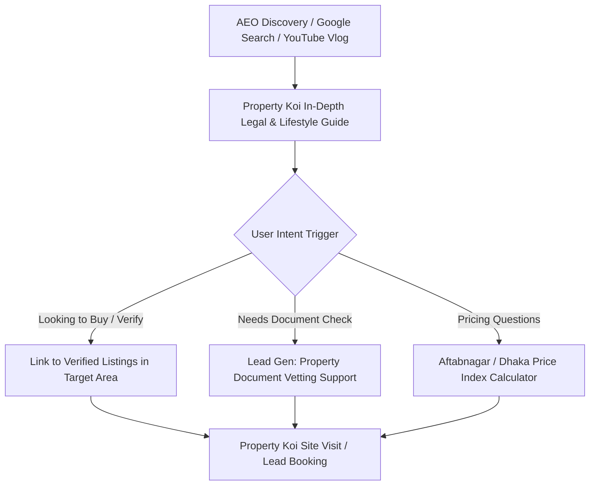

# Property Koi (https://propertykoi.com)
## 30-Day Human-Engaging & Vlog-Ready Content Strategy (2026)

This strategic content roadmap establishes **Property Koi** as Bangladesh's most engaging, helpful, and camera-ready real estate portal. Every topic is crafted to serve a **dual purpose**:
1. **Top-Tier SEO & AEO Knowledge Hub Guide**: Authoritative, clean HTML formatting, high-ranking search content, and bilingual FAQ schema.
2. **Turnkey YouTube/Facebook Vlog Script**: Written in a conversational, relatable human voice with a clear hook, real-world examples, and step-by-step advice that the host (Mithu A Quayium / Property Koi Desk) can present directly on camera.

---

### Core Editorial & Vlog Standards
1. **Human-Engaging Conversational Voice**:
   - Ditch sterile, bureaucratic language. Talk directly to the reader/viewer like an experienced, trustworthy elder brother or advisor ("আপনি কি জানেন...", "ধরুন আপনি একটি ফ্ল্যাট কিনলেন...", "যে ভুলটির কারণে মানুষ কোটি টাকা হারায়...").
2. **50:50 Topic Balance (Complex Legal vs Simple Everyday)**:
   - Alternate between complex statutory due diligence (ড্যাপ, খতিয়ান, মৌজা রেট, বায়া দলিল) and everyday, highly relatable consumer topics (প্রথমবার ফ্ল্যাট কেনা, ভাড়াটিয়া যাচাই, কম খরচে ইন্টেরিয়র, ব্যাংক হোম লোন, বাথরুম ওয়াটারপ্রুফিং)।
3. **Clean Conversational Narrative (Strictly NO Script/Camera Cues)**:
   - Start with a compelling human hook and an **"AEO Quick Summary / এক নজরে মূল তথ্য"** card. Never output camera directions, host cues, or teleprompter stage directions (`ক্যামেরা অন:`, `হোস্ট প্রম্পট:`, `ভিডিও ও স্ক্রিপ্ট শুরু`) into the text. The blog must read like an engaging, high-end article while being presentation-ready.
4. **Aggressive SEO & AEO Dominance Architecture**:
   - Provide direct-answer snippet blocks in the first 150 words for AI Overviews / Perplexity / ChatGPT scraping.
   - Dual-language AEO: Bengali body content + structured English `en_profile` (headline, description, dense abstract, keywords, and English FAQ schema) to ensure citation across global AI knowledge graphs.
   - Internal linking loop to `/properties`, `/calculators/registration`, `/calculators/rajuk-far`, and `/chahida`.
5. **Dynamic Category Balancing (Automated Writer Mandate)**:
   - When generating automated daily content, the system **MUST** inspect the current category distribution across published guides:
     ```bash
     php artisan tinker --execute="dump(App\Models\Guide::selectRaw('category, count(*) as count')->groupBy('category')->pluck('count','category')->toArray());"
     ```
   - Prioritize categories that currently have **0 or the lowest content count** (`construction`, `interior_design`, `finance`, `rental_tenancy`, etc.).
   - Always choose from the **15 Standard Knowledge Hub Categories** defined below.
5. **Dual-Language AEO Architecture**:
   - Bengali body content + structured English `en_profile` (headline, description, abstract, keywords, and English FAQ schema) to ensure citation across global AI knowledge graphs.

---

### The 15 Standard Knowledge Hub Categories

| Key | Bengali Label | English Name | Focus Scope |
|:---|:---|:---|:---|
| `legal_docs` | দলিল ও আইনি গাইড | Legal & Title Docs | বায়া দলিল, পাওয়ার অব অ্যাটর্নি, খাস জমি, অর্পিত সম্পত্তি, বালাম তল্লাশি |
| `land_survey` | ভূমি জরিপ ও খতিয়ান | Land Survey & Records | সিএস, এসএ, আরএস, সিটি ও বিএস খতিয়ান, ই-নামজারি, ডিসিআর, খাজনা দাখিলা |
| `rajuk_dap` | রাজউক ও ড্যাপ অনুমোদন | RAJUK & DAP Approvals | ড্যাপ (২০২২-২০৩৫), ফ্লোর এরিয়া রেশিও (FAR), অকুপেন্সি সনদ, ভবনের উচ্চতা ও নকশা |
| `registration_tax` | রেজিস্ট্রেশন ফি ও কর | Registration & Tax | সাব-রেজিস্ট্রি খরচ, স্ট্যাম্প শুল্ক, উৎসে কর (৫৩এইচ), মৌজা মূল্য ও মিউটেশন ফি |
| `buying_guides` | ক্রয়-বিক্রয় গাইডলাইন | Buying & Selling Guides | বায়নানামা, রেডি বনাম নির্মাণাধীন ফ্ল্যাট, লুকায়িত খরচ, ডেভেলপার চুক্তিপত্র |
| `finance` | রিয়েল এস্টেট ফাইন্যান্স | Real Estate Finance | ব্যাংক হোম লোন, মর্টগেজ, নন-এনকামব্রেন্স সার্টিফিকেট (NEC), কিস্তি হিসাব |
| `investment` | বিনিয়োগ ও ল্যান্ড শেয়ার | Investment & Land Share | ল্যান্ড শেয়ারিং প্রকল্প, যৌথ মালিকানা, মূলধনী প্রবৃদ্ধি ও রেন্টাল ইল্ড |
| `nrb_property` | প্রবাসী (NRB) প্রপার্টি | NRB Property Guides | প্রবাসী রেমিট্যান্স ইনসেন্টিভ, বিক্রয়লব্ধ অর্থ বিদেশে পাঠানো (Repatriation), পিওএ |
| `area_guides` | এরিয়া রিভিউ | Neighborhood & Area Guides | বসুন্ধরা, আফতাবনগর, উত্তরা, পূর্বাচল, ডিওএইচএস—ব্লক ও সেক্টরভিত্তিক লাইফস্টাইল |
| `market_insights` | মার্কেট অ্যানালাইসিস | Market Insights | ম্যাক্রো রিয়েল এস্টেট অ্যানালাইসিস, ফ্ল্যাটের মূল্যস্ফীতি, নির্মাণ সামগ্রীর দরপতন/বৃদ্ধি |
| `inheritance` | উত্তরাধিকার সম্পত্তি | Inheritance & Family | ফারায়েজ, ওয়ারিশি সনদ, বণ্টননামা (বাটোয়ারা), হেবা দলিল ও পারিবারিক সমঝোতা |
| `rental_tenancy` | বাড়িভাড়া ও ভাড়াটিয়া | Rental & Tenancy | বাড়িভাড়া নিয়ন্ত্রণ আইন, বাড়িওয়ালা-ভাড়াটিয়া চুক্তি, সার্ভিস চার্জ, কমন স্পেস অধিকার |
| `commercial` | বাণিজ্যিক প্রপার্টি | Commercial Real Estate | দোকান, বাণিজ্যিক ফ্লোর, শোরুম লিজ, অফিস স্পেস পজিশন কেনাবেচা ও ভ্যাট/ট্যাক্স |
| `construction` | বিল্ডিং কনস্ট্রাকশন | Building Construction | প্রতি বর্গফুট নির্মাণ খরচ, রড-সিমেন্ট গ্রেডিং, সয়েল টেস্ট, পাইলিং ও ভূমিকম্প সহনশীলতা |
| `interior_design` | ইন্টেরিয়র ডিজাইন | Interior Design & Decor | ফ্ল্যাট সাজানোর বাজেট, ফলস সিলিং, মডুলার কিচেন, বাথরুম ওয়াটারপ্রুফিং ও টাইলস |

---

### Editorial Schedule & Vlog-Ready Cluster Map

| Day | Topic & Primary Bengali Title | Slug & Category | Format & Vlog Angle | Core Keywords & Video Hook |
|:---|:---|:---|:---|:---|
| **Day 1** | **হেবা (Heba) দলিলের আইনি নিয়ম, সাব-রেজিস্ট্রি ফি, রক্তের সম্পর্ক ও নামজারি নির্দেশিকা ২০২৬** | `heba-dolil-rules-sub-registry-fees-process-bangladesh-2026`<br>`[inheritance]` | **আইনি নির্দেশিকা** | **Hook:** "কাউকে ভালোবাসে সম্পত্তি উপহার দিতে চান? মাত্র ২০০ টাকার স্ট্যাম্পে রক্ত সম্পর্কের হেবা করার পুরো নিয়ম।" |
| **Day 2** | **রাজউক ড্যাপ (DAP 2022-2035) ও FAR অনুযায়ী ফ্ল্যাট নির্মাণের নিয়ম ও ক্রেতার অধিকার** | `rajuk-dap-far-rules-flat-buyers-rights-dhaka-2026`<br>`[rajuk_dap]` | **প্র্যাকটিক্যাল গাইড** | **Hook:** "ফ্ল্যাটের ছাদ বা টপ ফ্লোর কি রাজউক অনুমোদিত? কেনার আগে যেভাবে FAR ও উচ্চতা যাচাই করবেন।" |
| **Day 3** | **জমি বা ফ্ল্যাটের বায়া দলিল (Baya Deed) হারিয়ে গেলে করণীয় ও বিকল্প আইনি প্রতিকার ২০২৬** | `lost-baya-dolil-remedies-certified-copy-sub-registry-2026`<br>`[legal_docs]` | **সমস্যা সমাধানমূলক** | **Hook:** "বায়া দলিল হারিয়ে গেছে? ভয় নেই! জিডি থেকে সাব-রেজিস্ট্রি বালাম বই নকল তোলার ৩টি সহজ ধাপ।" |
| **Day 4** | **পূর্বাচল নতুন শহর (Purbachal New Town) প্লট কেনাবেচার নিয়ম, রাজউক ফি ও খতিয়ান যাচাই ২০২৬** | `purbachal-new-town-plot-buying-guide-rajuk-transfer-2026`<br>`[area_guides]` | **এরিয়া রিভিউ / ভ্লগ** | **Hook:** "পূর্বাচলে প্লট কেনার সঠিক সময় কি এখনই? সেক্টর ১-৫ বনাম ২০+ এর কাঠাপ্রতি দর ও সম্ভাবনা।" |
| **Day 5** | **ফ্ল্যাট বা জমিতে ব্যাংক লিয়েন (Bank Lien) ও মর্টগেজ শনাক্ত করার নিয়ম: এনইসি (NEC) অনুসন্ধান** | `bank-lien-mortgage-verification-non-encumbrance-certificate-bangladesh`<br>`[finance]` | **প্রতারণা প্রতিরোধ** | **Hook:** "যে ফ্ল্যাটটি কিনছেন সেটি কি ব্যাংকে বন্ধক রাখা? জেনে নিন এনইসি (NEC) বের করার নিয়ম।" |
| **Day 6** | **বসুন্ধরা আবাসিক এলাকায় প্লট ও ফ্ল্যাট প্রাইস ট্রেন্ড ২০২৬: ব্লক অনুযায়ী কাঠাপ্রতি দাম ও সম্ভাবনা** | `bashundhara-ra-plot-flat-price-trend-block-analysis-2026`<br>`[area_guides]` | **এরিয়া রিভিউ / ভ্লগ** | **Hook:** "বসুন্ধরার কোন ব্লকে ফ্ল্যাট কেনা সবচেয়ে বুদ্ধিমানের কাজ? ব্লক A থেকে P কাঠাপ্রতি দামের ব্যবচ্ছেদ।" |
| **Day 7** | **জমি কেনার আগে সিটি জরিপ ও বিএস খতিয়ানে দাগ নম্বর ও হিস্যা যাচাইয়ের কৌশল** | `bs-khotian-city-survey-dag-hissya-verification-rules-2026`<br>`[land_survey]` | **মাস্টারক্লাস** | **Hook:** "খতিয়ানের আনা, গন্ডা, কড়া, ক্রান্তি বোঝা এত কঠিন না! সহজ গণিতে দাগ ও হিস্যা মেলানোর কৌশল।" |
| **Day 8** | **ডেভেলপারের সাথে ফ্ল্যাট ক্রেতার চুক্তিপত্র (Allotment & Handover Deed) ও রিয়েল এস্টেট আইন ২০১০** | `developer-allotment-handover-agreement-real-estate-act-2010`<br>`[buying_guides]` | **ক্রেতার অধিকার** | **Hook:** "ডেভেলপার ফ্ল্যাট বুঝিয়ে দিতে দেরি করছে? রিয়েল এস্টেট আইন অনুযায়ী কত টাকা ক্ষতিপূরণ পাবেন?" |
| **Day 9** | **প্রবাসী (NRB) বাংলাদেশিদের রেমিট্যান্স সুবিধায় সম্পত্তি ক্রয় ও বিক্রয়লব্ধ অর্থ বিদেশে পাঠানো (Repatriation)** | `nrb-remittance-property-purchase-funds-repatriation-bangladesh`<br>`[nrb_property]` | **প্রবাসী স্পেশাল** | **Hook:** "দেশে ফ্ল্যাট বা জমি বিক্রি করে সেই টাকা বিদেশে লিগ্যালি নেওয়া যায় কি? জেনে নিন বাংলাদেশ ব্যাংকের নিয়ম।" |
| **Day 10** | **অনলাইনে ই-নামজারিতে ডিসিআর (DCR) ও খাজনার দাখিলা পেমেন্ট এবং কিউআর কোড জালিয়াতি রোধ** | `e-namjari-dcr-land-tax-ldtax-online-payment-qr-verification-2026`<br>`[land_survey]` | **ডিজিটাল টিউটোরিয়াল** | **Hook:** "দালাল ছাড়া ঘরে বসেই মোবাইল দিয়ে নামজারি ফি ও খাজনা পরিশোধ করুন মাত্র ৫ মিনিটে।" |
| **Day 11** | **মিরপুর ডিওএইচএস বনাম উত্তরা: ২০২৬ সালে ফ্যামিলি লিভিং ও ফ্ল্যাট বিনিয়োগে কোনটি এগিয়ে?** | `mirpur-dohs-vs-uttara-flat-price-livability-comparison-2026`<br>`[area_guides]` | **কম্প্যারিজন ভ্লগ** | **Hook:** "নিরাপত্তা বনাম স্বাধীনতা: ডিওএইচএস-এর নিস্তব্ধতা নাকি উত্তরার প্রাণবন্ত জীবন—পরিবারের জন্য কোনটি সেরা?" |
| **Day 12** | **খাস জমি, অর্পিত সম্পত্তি (Vested Property) ও ভাওয়াল এস্টেটের জমি চেনার উপায়** | `vested-property-khas-land-abandoned-property-verification-bangladesh`<br>`[legal_docs]` | **ইনভেস্টিগেটিভ গাইড** | **Hook:** "১নং খাস খতিয়ান ও অর্পিত 'ক' তালিকাভুক্ত জমি বিক্রি করে দিচ্ছে প্রতারকরা! চেনার সহজ উপায়।" |
| **Day 13** | **ফ্ল্যাট মালিক কল্যাণ সমিতি (Apartment Owners Association) গঠন, সার্ভিস চার্জ ও ছাদের আইনি অধিকার** | `apartment-owners-association-formation-service-charge-rooftop-rights`<br>`[rental_tenancy]` | **কমিউনিটি লাইফ** | **Hook:** "ছাদ কি শুধু টপ ফ্লোরের মালিকের? সার্ভিস চার্জ না দিলে কি ব্যবস্থা নেওয়া যায়?" |
| **Day 14** | **জমি ও ফ্ল্যাটের মৌজা দর (Govt Minimum Mouza Value) ২০২৬: সাব-রেজিস্ট্রারে ট্যাক্স ফাঁকির ঝুঁকি** | `govt-mouza-rate-property-registration-tax-evasion-penalties-2026`<br>`[registration_tax]` | **ট্যাক্স ও লিগ্যাল** | **Hook:** "দলিল রেজিস্ট্রেশনে সরকারি মৌজা রেটের চেয়ে কম মূল্য দেখালে কি কি আইনি বিপদে পড়বেন?" |
| **Day 15** | **প্রথমবার ফ্ল্যাট কিনছেন? এই ৫টি মারাত্নক ভুল কখনোই করবেন না! (Buyer's Survival Guide)** | `first-time-flat-buyer-mistakes-checklist-bangladesh-2026`<br>`[buying_guides]` | **সহজ-সরল ভ্লগ** | **Hook:** "প্রথমবার নিজের বাড়ির স্বপ্ন দেখছেন? ব্রোশিওর দেখে ফ্ল্যাট কেনার আগে এই ৫টি সত্যি জেনে নিন।" |
| **Day 16** | **ভবন নির্মাণ খরচ ২০২৬: প্রতি বর্গফুট গ্রেড-১ রড, সিমেন্ট, রাজউক নকশা ও পাইলিং বাজেট নির্দেশিকা** | `building-construction-cost-per-sqft-materials-budget-bangladesh-2026`<br>`[construction]` | **বাজেট ও ইঞ্জিনিয়ারিং** | **Hook:** "২০২৬ সালে নিজের জায়গায় বাড়ি বানাতে প্রতি স্কয়ারফুটে কত টাকা খরচ পড়বে? রড-সিমেন্টের পাই-টু-পাই হিসাব।" |
| **Day 17** | **ঢাকায় ফ্ল্যাটের ইন্টেরিয়র ডিজাইন বাজেট ২০২৬: প্রতি স্কয়ারফুট খরচ, ফলস সিলিং, লাইটিং ও মেটেরিয়াল সিলেকশন** | `flat-interior-design-cost-budget-breakdown-dhaka-2026`<br>`[interior_design]` | **লাইফস্টাইল ও হোম ডেকর** | **Hook:** "অল্প বাজেটে ফ্ল্যাটকে লাক্সারি রূপ দেবেন যেভাবে: ফলস সিলিং ও মডুলার কিচেনের স্কয়ারফুট বাজেট।" |
| **Day 18** | **বাড়িভাড়া দেওয়ার আগে ৫টি জরুরি নিয়ম: খারাপ ভাড়াটিয়া এড়াবেন যেভাবে ও চুক্তিপত্রের নিয়ম** | `house-rent-control-act-tenant-landlord-agreement-bangladesh-2026`<br>`[rental_tenancy]` | **সহজ-সরল প্র্যাকটিক্যাল** | **Hook:** "ভাড়াটিয়া ফ্ল্যাট ছাড়ছে না বা ভাড়া বকেয়া রাখছে? বাড়িওয়ালাদের আইনি সুরক্ষার ৫টি অব্যর্থ নিয়ম।" |
| **Day 19** | **ব্যাংক হোম লোন পাওয়ার সবচেয়ে সহজ উপায় ২০২৬: সুদের হার, মর্টগেজ শর্তাবলী ও ফাইল প্রসেসিং** | `bank-home-loan-interest-rates-cib-approval-guide-bangladesh-2026`<br>`[finance]` | **ফাইন্যান্সিয়াল গাইড** | **Hook:** "স্যালারি একাউন্ট বা ব্যবসা থাকলে কীভাবে কম সুদে দ্রুত ব্যাংক হোম লোন পাবেন? সিআইবি ক্লিয়ারেন্স গাইড।" |
| **Day 20** | **বিল্ডিংয়ের ভূমিকম্প সহনশীলতা ও বিএনবিসি (BNBC 2020) কোড: সয়েল টেস্ট ও স্ট্রাকচারাল ডিজাইন যাচাই** | `earthquake-resistant-building-bnbc-code-soil-test-dhaka-2026`<br>`[construction]` | **নিরাপত্তা ও ইঞ্জিনিয়ারিং** | **Hook:** "ভূমিকম্প হলে আপনার ফ্ল্যাট কতটা নিরাপদ? কেনার আগে পাইলিং ও স্ট্রাকচারাল ড্রয়িংয়ে যা দেখবেন।" |
| **Day 21** | **মডার্ন কিচেন ও বাথরুম ইন্টেরিয়র ডিজাইন ২০২৬: ওয়াটারপ্রুফিং, টাইলস সিলেকশন ও আর্কিটেকচারাল সমাধান** | `modern-kitchen-bathroom-interior-waterproofing-cost-guide-2026`<br>`[interior_design]` | **হোম ইমপ্রুভমেন্ট** | **Hook:** "বাথরুমের স্যাঁতসেঁতে দেয়াল ও কিচেনের দুর্গন্ধ চিরতরে দূর করার ওয়াটারপ্রুফিং সিক্রেট।" |
| **Day 22** | **বাণিজ্যিক স্পেস ও দোকান (Shop & Office Space) কেনা এবং বিনিয়োগের নিয়ম: পজিশন কেনাবেচা ও সাব-কবলা দলিল** | `commercial-space-shop-office-buying-investment-rules-bangladesh-2026`<br>`[commercial]` | **কমার্শিয়াল ইনভেস্টমেন্ট** | **Hook:** "মার্কেটে দোকান বা শোরুম কেনা কি লাভজনক? পজিশন কেনা বনাম রেজিস্ট্রি দলিলের বড় পার্থক্য।" |
| **Day 23** | **জমি হস্তান্তরে ওয়ারিশি সনদ ও পারিবারিক বাটোয়ারা দলিল (Partition Deed) সম্পাদন বিধিমালা ২০২৬** | `warisi-certificate-family-partition-batowara-dolil-rules-2026`<br>`[inheritance]` | **পারিবারিক ও উত্তরাধিকার** | **Hook:** "পৈতৃক সম্পত্তি ভাগাভাগি নিয়ে ভাই-বোনের বিরোধ? রেজিস্টার্ড বাটোয়ারা দলিল যেভাবে করবেন।" |
| **Day 24** | **প্রাইভেট ল্যান্ড শেয়ার প্রকল্পে ফ্ল্যাট নির্মাণ: ঝুঁকি, খরচ সাশ্রয় ও যৌথ চুক্তিপত্রের রক্ষাকবচ** | `private-land-share-project-cost-saving-risk-mitigation-guide-2026`<br>`[investment]` | **স্মার্ট ইনভেস্টমেন্ট** | **Hook:** "ডেভলপারের চেয়ে ৩০% কম খরচে ল্যান্ড শেয়ারে ফ্ল্যাট বানানোর নিয়ম ও প্রতারণা এড়ানোর উপায়।" |
| **Day 25** | **আফতাবনগর জহুরুল ইসলাম সিটিতে প্লট ও ফ্ল্যাট ক্রয়ের চূড়ান্ত বায়ার্স গাইড ২০২৬: ব্লকভিত্তিক সম্ভাবনা** | `aftabnagar-johurul-islam-city-flat-plot-buyer-guide-2026`<br>`[area_guides]` | **এরিয়া রিভিউ / ভ্লগ** | **Hook:** "হাতিরঝিল সংলগ্ন আফতাবনগরের ব্লক A থেকে M: কোথায় বসবাস ও ইনভেস্টমেন্ট সবচেয়ে নিরাপদ?" |
| **Day 26** | **ফ্ল্যাট কেনার সময় লুকানো খরচ (Hidden Costs): ব্রোশিওরের বাইরে কত লাখ টাকা বাড়তি লাগে?** | `hidden-costs-of-buying-flat-dhaka-registration-utility-parking-2026`<br>`[buying_guides]` | **সহজ-সরল ভ্লগ** | **Hook:** "ফ্ল্যাটের দাম ৬০ লাখ, কিন্তু পকেট থেকে বের হবে ৭৫ লাখ! এই ১৫ লাখ টাকার লুকানো খরচগুলো কী?" |
| **Day 27** | **রেডি ফ্ল্যাট বনাম আন্ডার-কনস্ট্রাকশন ফ্ল্যাট: ২০২৬ সালে কার জন্য কোনটি কেনা লাভজনক?** | `ready-flat-vs-under-construction-flat-roi-decision-guide-2026`<br>`[buying_guides]` | **তুলনামূলক ভিডিও গাইড** | **Hook:** "চাবি হাতে নিয়ে উঠবেন নাকি নির্মাণাধীন ফ্ল্যাট কিনে কিস্তিতে শোধ করবেন? লাভ-ক্ষতির বাস্তব অংক।" |
| **Day 28** | **ছোট ফ্ল্যাট বড় দেখানোর ৭টি ইন্টেরিয়র ট্রিক: মিরর ইফেক্ট, লাইটিং ও মাল্টি-ফাংশনাল ফার্নিচার** | `small-apartment-space-saving-interior-hacks-dhaka-2026`<br>`[interior_design]` | **সহজ লাইফস্টাইল হ্যাকস** | **Hook:** "১০০০ স্কয়ারফুটের ফ্ল্যাটকেও দেখাবে ১৫০০ স্কয়ারফুট! স্পেস-সেভিং ৭টি জাদুকরী ইন্টেরিয়র হ্যাকস।" |
| **Day 29** | **ফ্ল্যাট কেনার পর প্রথম ১ মাসে যেসব সরকারি ও প্রশাসনিক কাজ শেষ করতে হবে (New Homeowner Checklist)** | `new-homeowner-first-30-days-checklist-mutation-desco-wasa-2026`<br>`[buying_guides]` | **প্র্যাকটিক্যাল চেকলিস্ট** | **Hook:** "ফ্ল্যাটের চাবি পেলেন? অভিনন্দন! কিন্তু মিষ্টি খাওয়ার আগে এই ৫টি সরকারি ট্রান্সফার কাজ দ্রুত শেষ করুন।" |
| **Day 30** | **ফ্ল্যাট কেনার পর নামজারি (Mutation) ও খারিজ আবেদন: এসি ল্যান্ড অফিসের পূর্ণাঙ্গ নির্দেশিকা ২০২৬** | `flat-mutation-namjari-khariz-process-ac-land-dhaka-2026`<br>`[land_survey]` | **মাস্টারক্লাস গাইড** | **Hook:** "অবিভক্ত জমিতে ফ্ল্যাটের নামজারি কীভাবে করবেন? মাত্র ১১৭০ টাকা সরকারি ফিতে ই-নামজারি করার পদ্ধতি।" |

---

### Programmatic Conversion Loop


